# linyuan-muse

「lin渊」的开源版：手机端原生 Android AI 助手（不是浏览器网页，也不需要自己部署服务器）。装到手机上就是一个常驻的 AI：能听、能说、能看屏幕、能操作手机、能联网办事、能拉一屋子专家开讨论会，还有一个会自己排时间醒来干活的「主动式助手」。

> 名字由来：早期版本叫「语音伴侣」，但功能早已远超"语音对话"，
> 那个名字会让接手项目的人一看就判定成"语音陪伴类应用"，故统一改为 **lin渊**（2026-10-06）。
> 开源发布对外用名 **linyuan-muse**；App 在手机上显示的名字保持 **lin渊**。
> 工程文件夹、工程名、代码包名（`com.linyuan.app`）、应用显示名已全部同步；
> 仅 `applicationId` 与数据库/偏好文件名因**数据兼容**保留旧值，见下方「关于内部标识」。

当前版本：`0.1.0`（minSdk 26 / targetSdk 35，约 7.4 万行 Java，**不使用 androidx**）。

## 界面预览 · Screenshots

<table>
<tr>
<td>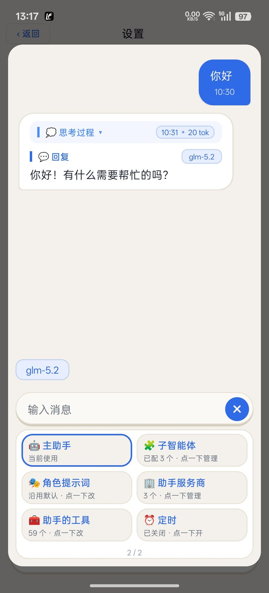</td>
<td>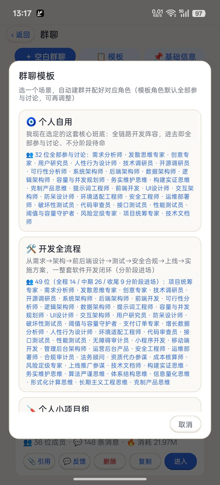</td>
<td>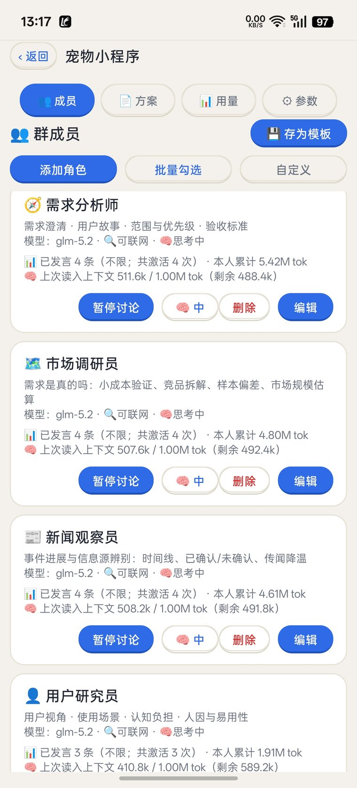</td>
</tr>
<tr>
<td>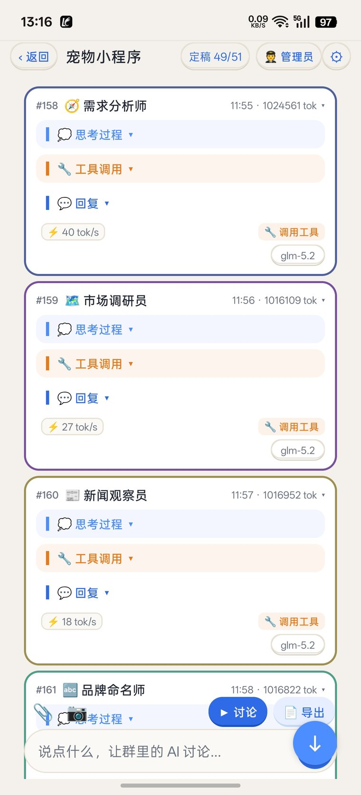</td>
<td>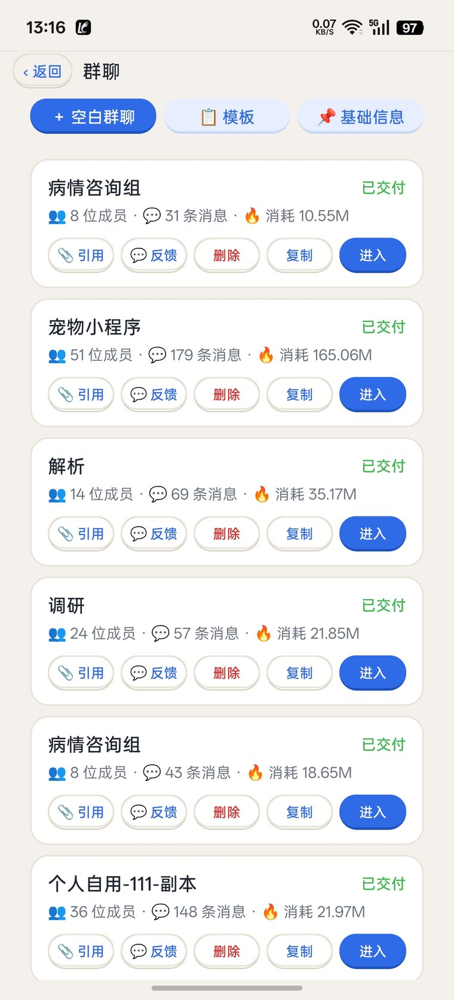</td>
<td>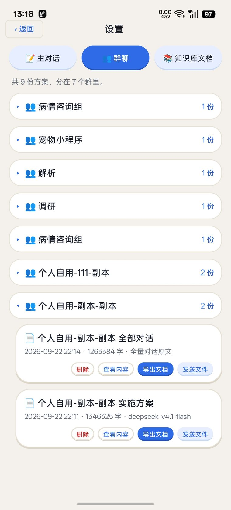</td>
</tr>
<tr>
<td>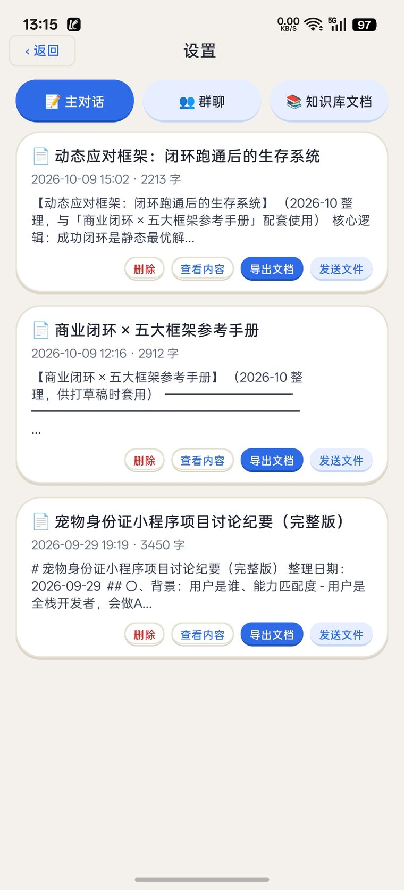</td>
<td>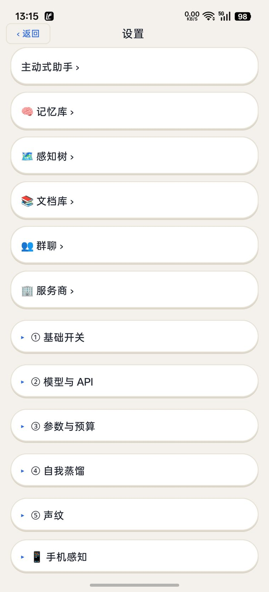</td>
<td>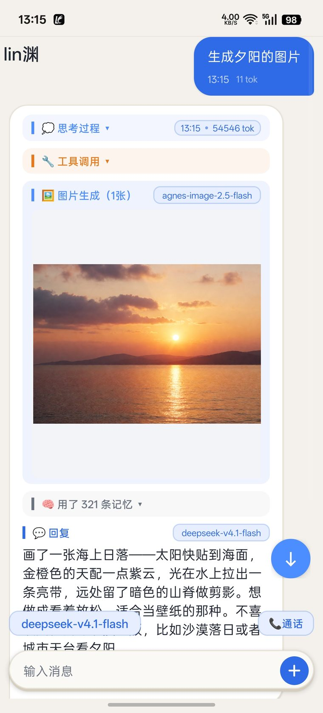</td>
</tr>
<tr>
<td>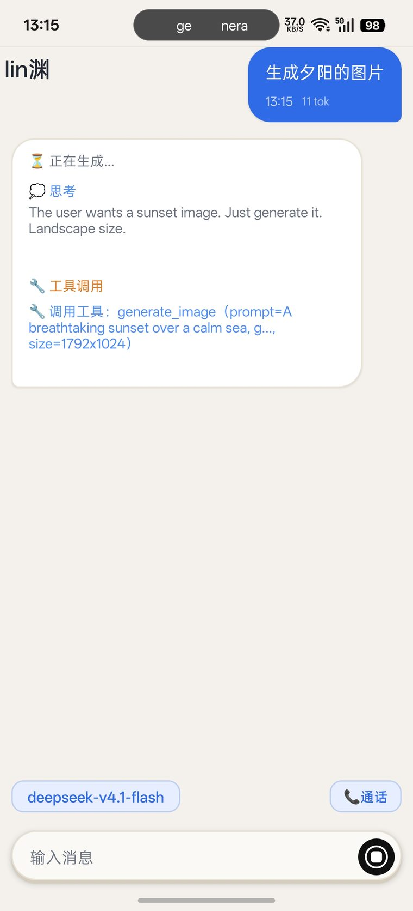</td>
<td>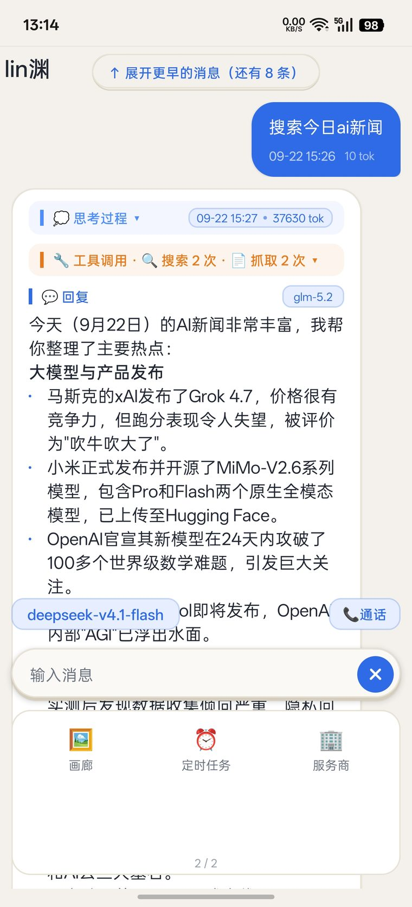</td>
<td>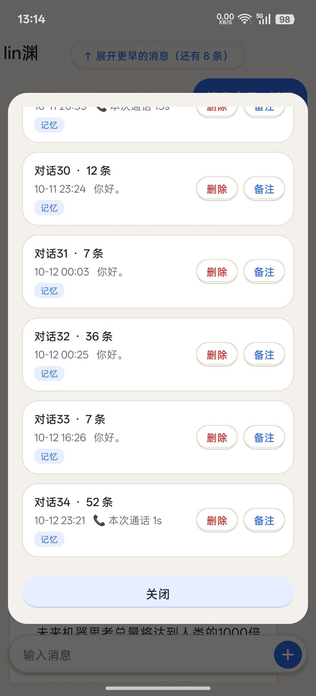</td>
</tr>
<tr>
<td>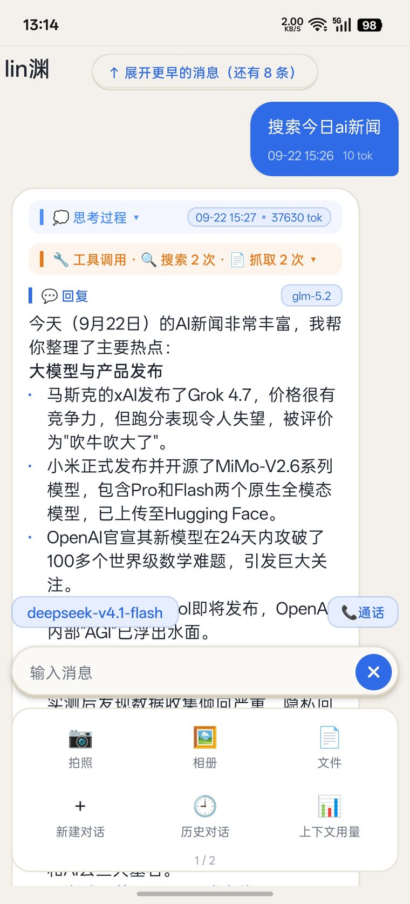</td>
<td>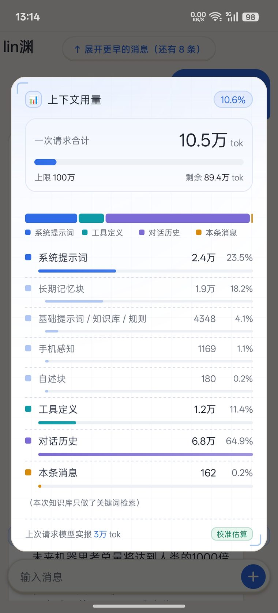</td>
<td>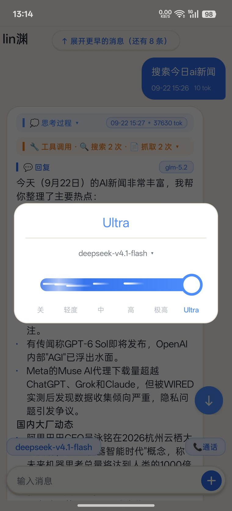</td>
</tr>
<tr>
<td>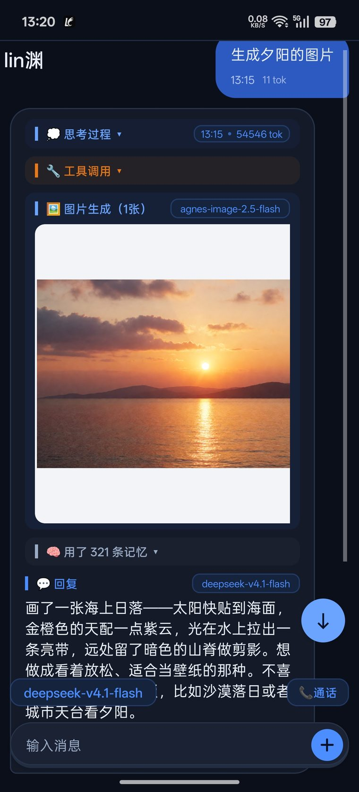</td>
<td>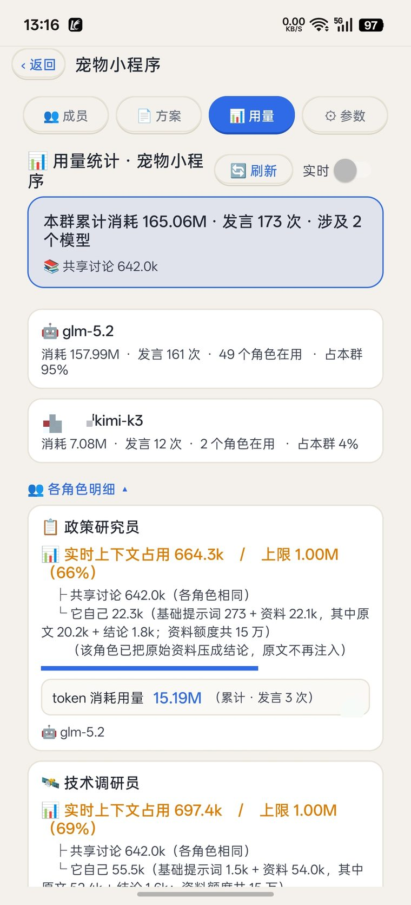</td>
<td></td>
</tr>
</table>

> 真机截图（OPPO 手机，含深/浅两套主题）。全部截图文件见 [`screenshots/`](screenshots/) 目录。

## 能力概览

### 主对话

- **流式输出**：生成过程中「思考 / 工具调用 / 回答」三区块分区实时展示，结束后自动折叠（长文回答可手动折叠）。
- **思考档位 6 档**（关 / 轻度 / 中 / 高 / 极高 / Ultra），自绘滑杆；档位会阶梯式换算成请求参数，并带**思考参数协商**——遇到不支持该参数的模型会自动降级重试，不会因为填了高档位就报错。
- **顶栏模型卡片**：点模型名直接切模型（列出当前服务商的可用模型），点档位切思考强度；服务商切换在输入条的「＋」面板里。
- **输入条**：点「＋」旋转成「×」弹出加号面板，面板两页可横滑，第二页是**画廊**与**定时任务**入口；📷 一个按钮三种附件（拍照 / 上传图片 / 上传文件），附件可预览、可撤回。
- **上下文用量弹窗**：按真实发送路径**实测一次请求**的组成（系统提示 / 记忆 / 工具 / 对话各占多少 token），先出卡片骨架再填实测数据。
- 长对话自动压缩；流式输出的重复退化检测；回复时间与 token 用量统计。
- 历史会话：列表限高（不会把按钮挤出屏幕）、备注徽章可编辑、图片画廊。

### 群聊讨论

- **角色库**：专家 / 开发角色 / 名人思维 / 我的模板，任意勾选组队；讨论时可检索**资料池**与**用户档案**（子代理也会被拉进来干活）。
- **成员管理**：管理员（AI 侧）可以用工具提案「加人 / 减人 / 改成员配置」，用户确认后生效。
- **四个阶段**：探索 → 深化 → 收敛 → 定稿，按成员确认比例自动推进。
- **预算守卫**：默认 100 万 token 上下文预算，到 95% 强制收尾（会提示你导出方案、另开新群继续）。
- **目标模式**：不限轮数（上限 9999 轮）一直讨论到全员确认。
- 需要你拍板的问题集中列出；讨论完可**一键导出方案**成文档，存进 App 的文档库。

### 工具体系（AI 自己按需调用）

全 App 共 **90 个工具**，按场景分组发放，不是一股脑全给：

| 场景 | 工具数 | 类别 |
| --- | --- | --- |
| 主对话 | 56 | 系统控制 16、内置浏览器 8、高德地图 9、通讯 5、文件/照片/日历 5、任务 3、图片生成 2、记忆与历史 4、群聊 2、联网 2 |
| 群聊 · 管理员 | 22 | 专家库、成员提案、讨论/计划/用量/进度、异常重试、档案、联网 |
| 群聊 · 成员 | 最多 13 | 提问、约定与收敛、资料池、用户档案、报告、拉专家 |
| 助手面板 / 子代理 | 最多 61 | 主对话全套按授权清单过滤（默认 59）+ 子代理调度 2 |
| 无人值守运行 | 6～8 | 排时间、写记忆、收感知、查历史等（不给动手类工具） |

工具覆盖：手电筒 / 音量 / 亮度 / 勿扰 / 闹钟 / 媒体控制、应用启停、无障碍模拟操作（点击、滑动、返回、读屏、剪贴板、输入）、点击脚本录制与回放、截图、联系人增删改查、打电话、收发短信、读通话记录、文件浏览读写、读照片、读写日历、内置浏览器（打开 / 搜索 / 点击 / 输入 / 读正文 / 取链接 / 后退 / 关闭）、高德地图（找地方 / 算路线 / 导航 / 定位 / 路况图层 / 天气）、图片生成、联网搜索与抓取网页、记忆与历史检索。

### 记忆与知识

- **SQLite 长期记忆**，检索是「关键词打分 + 向量余弦」的混合排序，向量模型默认 `Qwen/Qwen3-Embedding-0.6B`（地址与模型可换）。
- 记忆不再靠关键词即时抽取：**空闲 30 秒或切换对话时，由独立的记忆模型整理**（新增 / 改写 / 合并 + 实体抽取），可以单独配置它的服务地址、模型和 Key。
- **两本笔记**：用户记忆 与 AI 自己的 `self_note` 分开存放；助手面板侧还有它自己的一套记忆（指令 / 情节 / 判定 / 自述），与用户记忆隔离。
- 记忆入库时顶部弹一条小公告（「已记住 N 条」），2.6 秒后自动消失。
- **文档库**：导入文档按 500 字分块入库（上限 800 块），检索用余弦相似度取前 5。支持 PDF（**仅文字型**，扫描件会拒收）与纯文本类文件；**不支持 docx**（会被判为乱码拒收）。
- **备份 / 恢复**：一键导出 JSON（走系统保存框，默认存到 Download），可直接发到微信收藏；恢复时覆盖式导入记忆、知识库、对话、文档、感知档案。

### 感知记录（手机档案树）

- 「感知记录」把手机上的长期信息存成一棵**知识图谱式的档案树**，用可缩放拖拽的**思维导图画布**展示（父节点到子节点画树状曲线）。
- 注入上下文时**只带标题骨架**（每行 `#id` + 缩进），正文由 AI 用 `perception` 工具按 id 现查——省 token，也避免无关内容污染对话。
- 内置一份《感知档案通用框架》固定节点作为骨架路标。

### 语音

- **通话**：点底部「📞 通话」进入**免提连续通话**（不用按住说话），自动断句；再点一次挂断。通话中 AI 回复**自动朗读**（流式播报），你随时开口就能**打断**它。
- 非通话时的回复**不自动合成**：点气泡上的播放按钮才合成，合成过的会缓存，第二次点不再调 API（省额度）。
- **语音识别**：麦克风音频走你所配置的语音服务（阿里云百炼 DashScope 的 ASR 通道）。代码里保留了火山 / 豆包 ASR 的分支，但当前是**停用状态**（默认关、入口已隐藏）。
- **语音合成多通道兜底**：豆包双向流式 → 腾讯云 → 阿里云模型池 → 阿里云密钥池 → 单账号 → 其它，任何一级失败自动下探，不会因为某个通道挂掉就完全没声音。
- **端侧声纹**（默认关闭）：sherpa-onnx + CAM++ 声纹模型（`app/src/main/assets/voiceprint.onnx`），完全本地推理、不上传音频；打开后通话时先判断"是不是机主的声音"，不匹配就忽略这一段（模型或分析出错时放行，不会把你挡在外面）。
- **免费额度池**：CosyVoice 每月 1 万字符、Sambert 每月 3 万字符，跨月自动恢复；密钥池轮换、失败自动禁用 30 分钟；用网络授时校验日期（防改手机时间刷额度）。

### 主动式助手与自动化

- **主动式助手**：设置页最上面的入口，是一个与主对话同构的独立面板——有自己的模型、思考档位、角色提示词和记忆（独立存在 `assistant_panel` 偏好里，与主对话隔离）。它有「📊 用量」按钮（token 报告）与附件三件套（拍照 / 相册 / 文件，都是真功能）。
- **定时激活**：助手可以自己排时间醒来干活（工具 `schedule_self`，最小 5 分钟、最长 15 天，每 5 分钟最多建一个），无人值守运行时只带"排时间 / 写记忆 / 收感知 / 查历史"这类工具，不给动手类工具。
- **子代理**：可以创建多个命名子代理（各有自己的工具授权、上下文和思考档位），主对话/助手用 `call_subagent` 派活，子代理跑完回传结果；内置子代理不可改。
- **定时任务**：入口在输入条「＋」面板第二页的「⏰ 定时任务」。用 AlarmManager 精确闹钟（取不到精确闹钟权限会自动降级），支持编辑 / 暂停 / 恢复 / 删除，跑完把结果写回对话并按开关发通知。
- **微信自动回复**：同一个入口（「＋」面板第二页 → ⏰ 定时任务 → 「📱 微信自动回复」）。支持按「每天」或「每周几」设时段（可跨午夜，如周一、周三 23:00–03:00，表单里有实时预览），有总开关和单条时段暂停。注入用户记忆 / AI 自述 / 实体 / 知识库片段（不带助手那套记忆）；提示词只做"回微信消息"这一件事——拿不准的、敏感的（钱 / 承诺 / 隐私 / 吵架）不回复，绝不代替用户做承诺。
- **无障碍自动化**：AI 能模拟点击、滑动、返回 / 主页 / 通知栏 / 最近任务、读屏、写剪贴板、输入文字、截图；「点击脚本」可在全屏录制层上点坐标、拖动、撤销，保存后由 `tap_script` 回放。
- **手机感知工具**：位置、天气、步数、电量与系统状态、通知、使用时长等。

### 手机端集成（几个别人不一定有的）

- **打字通道（自研输入法）**：`LinYuanImeService` 是一个**无界面输入法**，用 `InputConnection.commitText()` 逐字往任意输入框打字（打字机效果），连微信这种"无障碍看不到输入框"的 App 也能打，且**能打中文**（`adb shell input text` 不行）。发送用 `performEditorAction()` 代替你按发送键，**发没发出去会读回核实**，不是盲报成功。语音命令「切到你的输入法 / 切回我的输入法」由 AI 调 `app_control(ime_on / ime_off)` 执行；**手动切过来会一直保持**（AI 打完也不自动切回），方便连续输多处（注：这个"保持"是运行时状态，服务重启后失效）。切回用 `InputMethodService.switchInputMethod()`，不需要任何权限。
- **桌面常驻灵动岛**：`SystemIslandService` + `BrowserIslandView` 画在挖孔两侧、绕过摄像头。App **在前台时隐藏、退到后台常驻**，**双击**即可切换通话模式（不进 App 就能像对讲机一样跟 AI 说话，再双击挂断）。瓣宽三档自动切换：桌面待命 `18dp` → 通话待命 `34dp` → 干活 / 用户说话 `58dp`。文字是滚动式字幕（右进左出），速度自适应，并与朗读音频进度同步（念到哪显示到哪）。
- **内置浏览器**：不跳出 App 就能打开网页、搜索、点击、输入（**拒填密码框**）、读正文、列可点链接、后退、关闭。
- **内置地图**：高德 SDK，找地方、算路线（含公交）、逐向驾车导航、定位、路况 / 卫星图层、天气。

## 生成 APK

需要 JDK 17（Android Studio 自带的 JBR 即可）和 Gradle 8.7（仓库不含 gradle wrapper，用你本机安装的即可）。设置好环境后执行：

```powershell
$env:JAVA_HOME = 'C:\Program Files\Android\Android Studio\jbr'
$env:ANDROID_HOME = '<你的 Android SDK 路径>'
& "<Gradle 8.7 路径>\bin\gradle.bat" assembleDebug
```

> 首次构建前先在仓库根目录建一个 `local.properties`，写入 `sdk.dir=<你的 Android SDK 路径>`（该文件已被 .gitignore 忽略）。

APK 输出在：

`app/build/outputs/apk/debug/app-debug.apk`

安装到已连接的手机：

```powershell
adb install -r app\build\outputs\apk\debug\app-debug.apk
```

**前置依赖**：仓库自带了 `sherpa-onnx-1.13.6-slim.aar`（Apache-2.0，随仓库分发）。
高德地图 SDK（`amap-navi-map-loc-search-11.3.100.jar`，约 106MB）是**专有 SDK，版本协议不允许随仓库分发**，
构建前请自行到[高德开放平台](https://lbs.amap.com/)下载并放入 `app/libs/`（文件名与版本号见 `app/build.gradle`）。
高德 Key 在 App「设置」里运行时配置，不接触源码。

## 真实 AI 设置

**两种填法：设置页里填，或者直接说给 AI 听。**

设置页里有界面的（`设置 → ② 模型与 API`）：语音合成（豆包 / 腾讯云，含密钥池与试听）、Embedding（向量化）、图片识别（Vision）、内置地图（高德，含本机签名 SHA1 显示）；`设置 → ① 基础开关 → 联网搜索` 里是搜索服务地址、密钥、密钥池与频率限制。

**对话模型、ASR、生图这些"核心项"设置页故意不给界面**——你直接对 AI 说「把生图地址和 Key 配成 xxx」，它用 `app_control(set_setting)` 写进去，也能 `get_settings` 读回来核实。可改的键：LLM（`api_key` / `model` / `base_url` / `system_prompt` / `max_tokens` / `temperature` / `top_p`）、开关（思考 / 记忆 / 联网）、TTS、ASR、Embedding、搜索（含 `search_key_pool`）、生图（`image_base_url` / `image_model` / `image_key_pool` / `image_concurrency`）、高德 `amap_api_key`。**删除类操作 AI 一律做不了，只能你手动点**（对话、记忆、设置都是如此）。

对话模型至少要有一个（阿里云百炼 / 火山方舟 / 任意 OpenAI 兼容服务都可以）：

- 阿里云百炼：地址 `https://dashscope.aliyuncs.com/compatible-mode/v1`，模型如 `qwen-plus`
- 火山方舟：地址 `https://ark.cn-beijing.volces.com/api/v3`，模型名填你在方舟控制台创建的接入点 ID
- OpenAI 兼容：填对应服务的兼容地址、模型名和 API Key

其它按需配置，留空即对应功能不可用：向量检索需要 Embedding 的 Key（地址与模型默认已是公开的硅基流动 + `Qwen/Qwen3-Embedding-0.6B`，Key 要自己填）；记忆整理可以单独指定模型，留空则用主对话模型；通话转写用阿里云百炼的 ASR；搜索与生图各需要一套「地址 + Key」的密钥池。

API Key 只写在手机 App 私有的偏好文件里（应用沙箱内，**没有额外加密**），不写入源码；「感知记录」收集到的手机数据另用系统密钥（AndroidKeyStore，AES-GCM）加密后落库。**公开版已清空内置的搜索 / 生图密钥池**，请填你自己的服务地址与 Key；没有 Key 时对应工具会直接报"未配置"，不影响其它功能使用。

## 关于内部标识（哪些改了、哪些**故意**没改）

改名覆盖：工程文件夹（`lin渊-android`）、工程名（`settings.gradle`，开源副本用 ASCII `linyuan`）、**代码包名 `com.linyuan.app`**、应用显示名、无障碍 / 通知服务名、全部用户可见文案、README 指引文字。

以下标识保持历史命名 `voicecompanion`，因为改动会造成**真实损失**（不只是"看起来不一致"）：

| 标识 | 位置 | 改了的后果 |
|---|---|---|
| `applicationId com.voicecompanion.app` | `build.gradle` | 变成**另一个 App**：老用户升级＝数据全丢，运行时权限、无障碍、通知使用权要全部重新授予 |
| 数据库名 `voice_companion.db` | `AppDatabase` | 找不到老库，记忆/对话/文档全没 |
| SharedPreferences `voice_companion` | 多处 | 所有设置（含 API Key）丢失 |

> 代码包名（namespace）与 applicationId 是两件事：前者只影响源码组织，可以安全改；后者是应用在系统里的身份，改了就是新应用。本项目只改了前者。

新生成的图片改存新目录 `Pictures/lin渊/`；旧目录 `Pictures/VoiceCompanion/` 的图仍在，两者都不删。

## 当前能力边界

- **不是 WebRTC 全双工实时音频**：通话是「VAD 自动断句 → 识别 → 流式回答 → 流式朗读」的回合制，延迟和豆包 / ChatGPT 手机端那种连续音频流不是一回事。要那一步得接具体厂商的实时语音 SDK 或 WebSocket / WebRTC 接口。
- **不内置任何 Key**：对话、搜索、生图、语音、向量、地图都要你自己配；配不全时对应能力不可用（不会假装能用）。
- **语音识别依赖所选服务**：火山 / 豆包 ASR 分支目前停用，通话转写走 DashScope 通道。
- **文档库只吃文字型 PDF 与纯文本**，不支持 docx / 扫描件 / 图片文字。
- **只在 Android 上**（minSdk 26，实测机型 ColorOS），没有 iOS 版、没有桌面版。
- **耗 token 的功能要看着用**：群聊讨论、主动式助手、无人值守任务都会持续消耗额度，群聊有 95% 预算硬停，其余没有硬上限。
- **没有单元测试**：验证方式 = 构建成功 + 真机实测。

## 开发约定

- **纯框架工程**：`android.useAndroidX=false`，不能引 androidx 依赖（Markdown 用 commonmark 自己 span 化，FileProvider 是自研的）。
- **依赖是本地 jar/aar**：高德 SDK、sherpa-onnx，不走 Maven（高德 jar 需按上文自行下载）。
- **没有单元测试**：验证方式 = 构建成功 + 真机实测。
- **开发记录不进仓库**：内部的开发日志与问题手册属于作者私有文档，不随仓库分发；代码改动留痕看 commit 历史。

界面上的两条硬约定（改按钮 / 弹窗前先读）：

- **按钮立体感**＝按钮底图自己画的"厚度"：`layer-list` 两层——底面（深一档同色）+ 面孔（`android:bottom="2dp"`），下缘露出约 2dp 深色带。`themes.xml` 的 `LinYuanButton` 已在主题级关掉系统阴影（`stateListAnimator=@null` + `elevation=0dp`）。改外观请改 `btn_secondary` / `btn_primary` / `btn_ghost` / `btn_danger` 这四个底图，厚度色在 `colors.xml` 的 `btn*Depth`。
- **设置页返回条**：「‹ 返回」用小方形（`btn_ghost_square`，radius 6dp，高 28dp），**不要**用 `btn_ghost`（999dp 胶囊）；返回条用 `FrameLayout`——返回按钮 `gravity=start`、标题 `gravity=center`（用 `LinearLayout` + weight 会让标题跟着按钮宽度偏）。

## 素材来源与致谢

App 内置的群聊角色提示词库（开发角色 / 名人思维 / 工程师人格等）**大部分收集自 GitHub 开源提示词项目，或在其基础上经 AI 蒸馏改编，并非本项目原创**；已知来源与其许可证、"无法追溯来源"部分的诚实说明，见 **[CREDITS.md](CREDITS.md)**（英文版：[CREDITS.en.md](CREDITS.en.md)）。如你是原作者、希望补充署名或要求移除相关内容，欢迎开 Issue 联系我们。

## 许可证

[GNU AGPL-3.0](LICENSE)（GNU Affero 通用公共许可证第 3 版）。

- 使用、修改、分发都自由，但**衍生作品必须同样以 AGPL-3.0 开源**，不允许改成闭源；
- 与 GPL 的关键区别（第 13 条）：**就算你只把它部署成网络服务给别人用、一个字节都不分发，也必须向使用者提供完整源码**；
- 商用并没有被禁止，但商用方同样受"必须开源"的约束。

> 随仓库分发的第三方组件许可证：sherpa-onnx（Apache-2.0）、commonmark（BSD-2-Clause）、kotlin-stdlib（Apache-2.0）、端侧声纹模型 voiceprint.onnx（3D-Speaker CAM++，经 sherpa-onnx 分发，Apache-2.0；详见 [CREDITS.md](CREDITS.md)）。
> 高德地图 SDK 为专有软件，不随仓库分发（需自行下载，另受高德开放平台协议约束）。

---

[English version → README.en.md](README.en.md)
